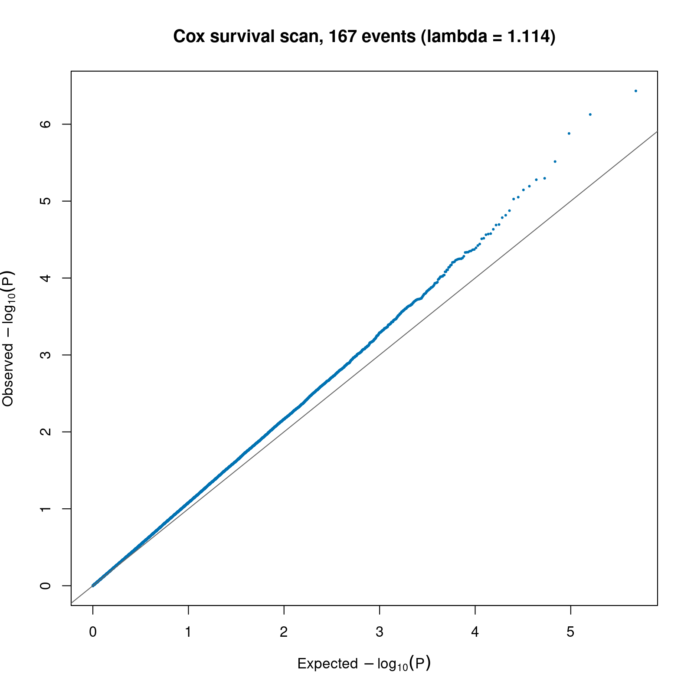

```{r}
#| include: false
source(file.path(Sys.getenv("QUARTO_PROJECT_DIR", "../.."), "R/facts.R"))
S  <- "04B_association_survival"
lm4b <- function(key) val(S, "pdac_demo_04B_lambda.tsv", key)
sm   <- function(pattern) grab(S, "pdac_demo_04B_summary.txt", pattern)
n_ind  <- as.integer(lm4b("n_individuals")); n_ev <- as.integer(lm4b("n_events"))
n_cens <- as.integer(lm4b("n_censored")); n_par <- as.integer(lm4b("n_parameters"))
epp    <- lm4b("events_per_parameter")
n_pc   <- as.integer(sm("primary model: SEX, AGE, PC1-PC([0-9]+)"))
n_pca_var <- as.integer(lm4b("pca_variants"))
n_test <- as.integer(lm4b("variants_tested")); n_skip <- as.integer(lm4b("variants_skipped"))
lam_obs <- as.numeric(lm4b("lambda")); lam_1000 <- lm4b("lambda_per_1000_events")
n_gws  <- as.integer(lm4b("genome_wide_sig")); n_sugg <- as.integer(lm4b("suggestive"))
exp_sugg <- sm("expected under the null at 1e-5: ([0-9.]+)")
maf_floor <- sm("minor allele frequency floor, evaluated in this set: ([0-9.]+)")
th <- tab(S, "pdac_demo_04B_top_hits.tsv"); lead <- th[which.min(th$P), ]
# 03B: smallest detectable HR for this event count
SP <- "pdac_demo_07_survival_power.txt"
hr30 <- grab("03B_statistical_power", SP, "MAF 0\\.30: HR ([0-9.]+)")
hr10 <- grab("03B_statistical_power", SP, "MAF 0\\.10: HR ([0-9.]+)")
ev_15 <- grab("03B_statistical_power", SP, "detect HR 1\\.5 at MAF 0\\.30 with 80% power: ([0-9,]+) events")
sv_ev <- grab("03B_statistical_power", SP, "observed events: ([0-9]+)")
if (as.integer(sv_ev) != n_ev) stop("event count differs between 03B and 4B")
# 02: three test statistics on a random subset of variants
cal <- tab(S, "pdac_demo_04B_calibration.tsv")
lgc <- function(p) { p <- p[is.finite(p)]; median(qchisq(p, 1, lower.tail = FALSE)) / qchisq(0.5, 1) }
cal_n <- sum(is.finite(cal$P_wald))
cal_l <- sapply(cal[c("P_wald", "P_lr", "P_score")], lgc)
# 03: covariate cost and the comparison of components
cc  <- tab(S, "pdac_demo_04B_covariate_cost.tsv")
pcc <- tab(S, "pdac_demo_04B_pc_comparison.tsv")
# 04: permutation null
ps <- tab(S, "pdac_demo_04B_perm_summary.tsv"); rownames(ps) <- ps$model
pv_ <- tab(S, "pdac_demo_04B_perm_validation.tsv")
n_perm <- as.integer(ps["primary", "n_perm"])
pl <- tab(S, "pdac_demo_04B_perm_lambda.tsv")
maf_cls <- setdiff(names(pl), c("model", "fit", "n_valid_P", "lambda"))
by_maf <- function(m, f) if (f == "observed") unlist(pl[pl$model == m & pl$fit == "observed", maf_cls]) else
  colMeans(pl[pl$model == m & grepl("^perm", pl$fit), maf_cls])
nmaf <- tab(S, "pdac_demo_04B_perm_variants_by_maf.tsv")
# 05: does the outcome depend on ancestry?
ad <- tab(S, "pdac_demo_04B_ancestry_dependence.tsv")
adp <- function(test) { r <- ad[ad$test == test, ]; if (nrow(r) != 1) stop("test not found: ", test); r }
grp <- tab(S, "pdac_demo_04B_ancestry_dependence_groups.tsv"); rownames(grp) <- grp$group
pc_single <- ad[grepl("^within-set PC[0-9]+ given SEX \\+ AGE, Cox Wald$", ad$test), ]
ph <- tab(S, "pdac_demo_04B_ph_check.tsv")
# Section 4A, for the contrast with the binary scan on the same people
lam4a <- val("04A_association_binary", "pdac_demo_04A_lambda.tsv", "lambda_gc")
words <- c("none", "one", "two", "three", "four", "five", "six", "seven", "eight", "nine", "ten",
           "eleven", "twelve")
w <- function(n) if (n <= 12) words[n + 1] else num(n)
```

Pancreatic cancer is a disease in which survival after diagnosis is short and varies little, and
that makes germline determinants of survival both interesting and hard to find. A survival scan
asks, for each variant, whether carrying it changes the hazard of death among people who already
have the disease. The data are a case series with follow-up, and the model is Cox proportional
hazards regression.

This page runs that scan on the European cases of the demonstration dataset. The point is not
the result. The simulation gives no variant, and no covariate, any effect on survival
(`demo_dataset/scripts/04_simulate_phenotype.R`), so the scan is null by construction. What the
page shows is how a null survival scan of realistic size behaves, and in particular that its
inflation factor is not 1.00 even when nothing is there.

```bash
how-to-gwas-pdac/
├── sections/04B_association_survival/   # scripts and committed results
└── results/assoc/                       # where the scripts write
```

::: {.callout-tip title="Before you start"}
Finish [Association testing: case-control](../04A_association_binary/04A_association_binary.qmd)
and read the survival part of [Statistical power](../03B_statistical_power/03B_statistical_power.qmd).
The scripts of this section sit directly in `sections/04B_association_survival/` and are run from
the repository root, as `scripts/dev/run_all.sh` runs them.
:::

---

## 01 - The scan, and the number that governs it

```bash
Rscript sections/04B_association_survival/01_cox_survival.R
```

The analysis set is the European cases with follow-up, sex and age. Principal components are
recomputed inside this set, on `r num(n_pca_var)` pruned variants, because the set is defined by the
intersection of ancestry, case status and follow-up and did not exist as a group when the Section 2
components were computed.

| | |
|---|---|
| Cases with follow-up | `r num(n_ind)` |
| Events | **`r num(n_ev)`** (`r num(n_cens)` censored) |
| Model | SEX, AGE, within-set PC1-PC`r n_pc` (`r n_par` parameters) |
| Events per parameter | `r epp` |
| Minor allele frequency floor, in this set | `r maf_floor` |
| Variants tested | `r num(n_test)` (`r num(n_skip)` without a valid fit) |
| λ | `r dec(lam_obs, 4)` (λ per 1,000 events `r dec(lam_1000, 4)`) |
| *P* < 5 × 10⁻⁸ | `r n_gws` |
| *P* < 1 × 10⁻⁵ | `r n_sugg`, against `r exp_sugg` expected under the null |
| Lead variant | `r lead$ID`, HR `r dec(lead$HR, 2)`, *P* = `r sci(lead$P)` |

The figure that governs power is the event count, `r num(n_ev)`, not the `r num(n_ind)` individuals. With
that many events, the smallest hazard ratio detectable at 80% power and genome-wide significance
is `r hr30` at a minor allele frequency of 0.30 and `r hr10` at 0.10; a hazard ratio of 1.5 at 0.30 would
need `r ev_15` events ([Statistical power](../03B_statistical_power/03B_statistical_power.qmd)).
A null result at this size is the expected outcome, and it is uninformative rather than negative.

The event count also limits the model. Each covariate spends information, and
`r epp` events per parameter is close to the conventional floor of ten. That is why
the script fits a second model with fewer components and reports both (step 03).



The QQ plot lifts off the diagonal along its whole length. In a case-control scan that would be
read as uncorrected structure. Here it would be the wrong reading, and the rest of the page is
about why. The binary scan on the European analysis set, which includes these individuals, has
λ = `r dec(lam4a, 3)` ([Association testing: case-control](../04A_association_binary/04A_association_binary.qmd)).

---

## 02 - Is it the test statistic?

```bash
Rscript sections/04B_association_survival/02_test_calibration.R
```

The scan uses the Wald test, which is anti-conservative at low events per parameter. If that were
the cause, the likelihood-ratio and score tests on the same fits would be close to 1.00. The step
refits a random subset of variants with all three statistics; the null model for the
likelihood-ratio and score tests is fitted on the same individuals as the full model.

| Statistic | λ on `r num(cal_n)` variants |
|---|---|
| Wald | `r dec(cal_l["P_wald"], 4)` |
| Likelihood ratio | `r dec(cal_l["P_lr"], 4)` |
| Score | `r dec(cal_l["P_score"], 4)` |

All three are inflated together, so the Wald test is not the explanation. This step uses the
Section 4A components (`results/assoc/pdac_demo_04A_covar.txt`), not the within-set ones, and its
printed advice points to residual structure among the cases. Steps 04 and 05 test that reading
directly and reject it.

---

## 03 - What the covariates cost

```bash
Rscript sections/04B_association_survival/03_covariate_cost.R
```

The power calculation of Section 3B is for a marginal test. The scan fits `r n_par` parameters. This
step refits a random subset of variants under four covariate sets and reports the median standard
error of the genotype coefficient, its ratio to the unadjusted fit, and λ.

| Covariates | Parameters | Events per parameter | Median SE | SE ratio | λ |
|---|---|---|---|---|---|
`r paste(sprintf("| %s | %d | %s | %s | %s | %s |", cc$covariates, cc$n_parameters, dec(cc$events_per_par, 1), dec(cc$median_SE, 4), dec(cc$SE_inflation, 3), dec(cc$lambda, 4)), collapse = "\n")`

The precision cost of the full model is modest, a factor of `r dec(cc$SE_inflation[nrow(cc)], 3)` on the standard error and
hence on the log of the detectable hazard ratio. The calibration cost is larger: λ rises with
every block of covariates added, although the outcome, by construction, depends on none of them.

The scan itself fits three variants of the model on the full variant set, which isolates the
components:

| Components | Parameters | Events per parameter | λ | *P* < 1 × 10⁻⁵ |
|---|---|---|---|---|
`r paste(sprintf("| %s | %d | %s | %s | %d |", pcc$model, pcc$n_par, dec(pcc$events_per_par, 1), dec(pcc$lambda, 4), pcc$suggestive), collapse = "\n")`

Components computed within the set and components borrowed from Section 4A give similar λ, so
borrowing is not the source of the inflation. Halving the number of components lowers λ.

---

## 04 - The permutation null

```bash
Rscript sections/04B_association_survival/04_permutation_null.R
```

**Why.** An observed λ cannot by itself separate confounding, signal and a miscalibrated test.
Permuting the outcome can. The step assigns the (time, event) pairs jointly to a permuted order of
individuals, keeping each individual's genotypes, sex, age and components together. Confounding and
signal do not survive the permutation; a property of the test at this sample size does. It does
this `r n_perm` times (seed `r ps["primary", "seed"]`) for two models, the primary one and SEX plus AGE only,
applying the same permutations to both, and first checks that its refit of the primary scan
reproduces the canonical one (`r num(pv_$n_matched_canonical)` of `r num(pv_$n_variants_here)` variants, largest difference
in *P* `r pv(pv_$max_abs_diff_P, 2)`).

| Model | Observed λ | Permutation mean | SD | Range | At or above observed | Empirical *P* |
|---|---|---|---|---|---|---|
| SEX, AGE, within-set PC1-PC`r n_pc` | `r dec(ps["primary", "lambda_observed"], 4)` | `r dec(ps["primary", "perm_mean"], 4)` | `r dec(ps["primary", "perm_sd"], 4)` | `r dec(ps["primary", "perm_min"], 4)` to `r dec(ps["primary", "perm_max"], 4)` | `r ps["primary", "n_perm_at_or_above_observed"]` of `r n_perm` | `r dec(ps["primary", "empirical_P"], 2)` |
| SEX, AGE | `r dec(ps["no_pc", "lambda_observed"], 4)` | `r dec(ps["no_pc", "perm_mean"], 4)` | `r dec(ps["no_pc", "perm_sd"], 4)` | `r dec(ps["no_pc", "perm_min"], 4)` to `r dec(ps["no_pc", "perm_max"], 4)` | `r ps["no_pc", "n_perm_at_or_above_observed"]` of `r n_perm` | `r dec(ps["no_pc", "empirical_P"], 2)` |

The empirical *P* is (number of permutations at or above the observed value + 1) / (`r n_perm` + 1).

Three things follow.

1. **In both models the observed λ is an ordinary draw from its own null.** The inflation survives
   the permutation, so it is neither confounding nor signal. It is what the Cox tests give at
   `r num(n_ev)` events with this covariate set.
2. **The components raise the null λ** from `r dec(ps["no_pc", "perm_mean"], 4)` to `r dec(ps["primary", "perm_mean"], 4)` and remove
   nothing, because there is nothing to remove (step 05).
3. **A single λ from correlated variants is noisy.** The standard deviation across permutations,
   `r dec(ps["primary", "perm_sd"], 4)` for the primary model, is the uncertainty of one λ here. A difference between two
   covariate sets smaller than that is not evidence about either.

The inflation is flat across allele frequency, observed and permuted, so the usual argument that
confounding shows as a frequency gradient does not discriminate here.

| MAF class | Variants | Observed λ, primary | Permutation mean, primary | Observed λ, SEX and AGE | Permutation mean, SEX and AGE |
|---|---|---|---|---|---|
`r o1 <- by_maf("primary", "observed"); m1 <- by_maf("primary", "perm"); o2 <- by_maf("no_pc", "observed"); m2 <- by_maf("no_pc", "perm"); paste(sprintf("| %s | %s | %s | %s | %s | %s |", maf_cls, num(nmaf$n_variants[match(maf_cls, nmaf$maf_class)]), dec(o1, 4), dec(m1, 4), dec(o2, 4), dec(m2, 4)), collapse = "\n")`

::: {.callout-important title="Read λ of a survival scan against its permutation null, not against 1.00"}
The observed λ of `r dec(lam_obs, 4)` would, read against 1.00, prompt more components. Read against the null of
the same model, `r dec(ps["primary", "perm_mean"], 4)` (SD `r dec(ps["primary", "perm_sd"], 4)`), it is unremarkable, and the corrective
it calls for is the opposite: fewer covariates, or a permutation-calibrated threshold for anything
read from the scan. The suggestive count, `r n_sugg` against `r exp_sugg` expected for a calibrated test, needs the same
treatment; the permutations here record λ, not that count, so its null distribution is not
measured on this page.
:::

---

## 05 - Does the outcome depend on ancestry at all?

```bash
Rscript sections/04B_association_survival/05_ancestry_dependence.R
```

**Why.** The simulation gives survival no dependence on ancestry. This step checks that on the
released data instead of assuming it, first among all cases with follow-up across the three
ancestry groups, before QC, and then within the European survival set.

| Group | Cases with follow-up | Events | Events (%) | Median time |
|---|---|---|---|---|
`r paste(sprintf("| %s | %s | %s | %s | %s |", c(afr = "African", eas = "East Asian", eur = "European")[grp$group], num(grp$n), num(grp$events), dec(grp$pct_events, 1), dec(grp$median_time, 1)), collapse = "\n")`

| Test | n | Events | df | Statistic | *P* |
|---|---|---|---|---|---|
`r tt <- c("ancestry group, Cox LR", "ancestry group given SEX + AGE, Cox LR", "ancestry group, log-rank", paste0("within-set PC1-PC", n_pc, " jointly given SEX + AGE, Cox LR"), paste0("Section 4A PC1-PC", n_pc, " jointly given SEX + AGE, Cox LR")); paste(sapply(tt, function(t) { r <- adp(t); sprintf("| %s | %s | %s | %d | %s | %s |", t, num(r$n), num(r$events), r$df, dec(r$statistic, 2), dec(r$P, 3)) }), collapse = "\n")`

Tested one at a time, given sex and age, the smallest *P* among the `r nrow(pc_single)` within-set components is
`r dec(min(pc_single$P), 3)`. Neither at the level of ancestry group nor along the components does the outcome
carry detectable structure. Together with step 04, this leaves no room for confounding by ancestry
as the explanation of the inflation of step 01, and the components in the model can only cost
calibration.

---

## 06 - Proportional hazards at the top of the scan

The Cox model assumes that a variant's hazard ratio is constant over follow-up. The scan checks
this for its `r nrow(ph)` most associated variants with the scaled Schoenfeld-residual test
(`cox.zph`, `pdac_demo_04B_ph_check.tsv`). For the genotype term, `r k <- sum(ph$PH_P_genotype < 0.05); w(k)` of the `r nrow(ph)` `r if (k == 1) "reaches" else "reach"`
*P* < 0.05, against `r dec(0.05 * nrow(ph), 0)` expected by chance. A variant whose effect is concentrated early
or late in follow-up would show here, and its single hazard ratio would then be an average of
something that changes.

---

## How to report a survival scan

Report, together:

- the event count and the number of censored observations, not only the number of individuals;
- the covariates and the events per parameter;
- λ **with its permutation null** for the model used, and the standard deviation of that null;
- the smallest hazard ratio detectable at 80% power for that event count;
- the suggestive count against the count expected under the null.

Without these a reader cannot tell an uninformative scan from a negative one, or an inflated scan
from a confounded one.

## Limits of this demonstration

- The outcome is null by construction. The page shows calibration and the cost of covariates; it
  cannot show the power to detect a true survival effect, which Section 3B computes.
- `r n_perm` permutations measure the null mean to about a tenth of its standard deviation and give an
  empirical *P* no smaller than 1/`r n_perm + 1`. That is enough to place the observed λ inside the null;
  it would not be enough to calibrate a genome-wide threshold.
- Steps 02 and 03 work on random subsets of variants, so their λ values differ from the full-scan
  value by sampling, and step 02 uses the Section 4A components.
- The scripts of this section are not copied by the project set-up of
  [Getting started](../../getting_started.qmd), which copies only `scripts/` folders; run them from
  a clone of the repository.

## Key decisions on this page

- The analysis set and the outcome: cases only, time from diagnosis, events counted.
- How many covariates the event count can afford, measured rather than assumed.
- The reference against which λ is read: the permutation null of the model fitted.
- Whether anything from an underpowered scan is reported beyond the calibration and the power.
