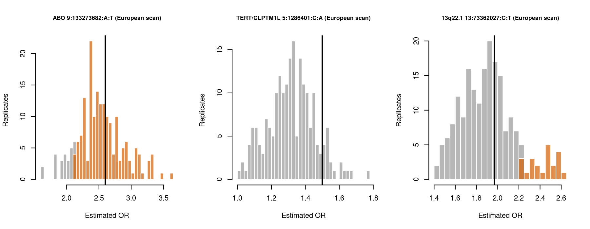
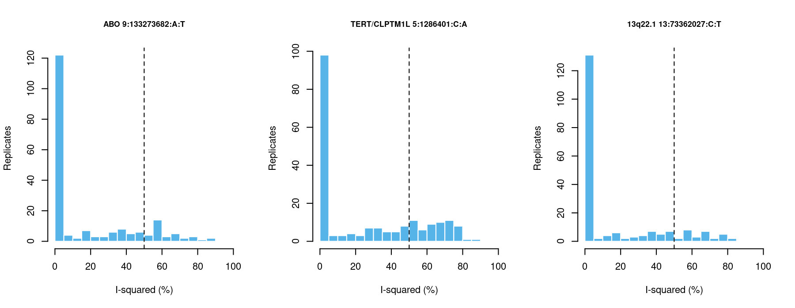

```{r}
#| include: false
source(file.path(Sys.getenv("QUARTO_PROJECT_DIR", "../.."), "R/facts.R"))
S  <- "08_replicates"
pw <- tab(S, "pdac_demo_08_power.tsv")
wc <- tab(S, "pdac_demo_08_winners_curse.tsv")
fm <- tab(S, "pdac_demo_08_finemap.tsv")
i2 <- tab(S, "pdac_demo_08_i2.tsv"); rownames(i2) <- i2$locus
lsum <- tab(S, "pdac_demo_08_lambda_summary.tsv"); rownames(lsum) <- lsum$lambda
lam <- tab(S, "pdac_demo_08_lambda.tsv")
rz <- tab(S, "pdac_demo_08_realised.tsv")
es <- tab(S, "pdac_demo_08_expected_se.tsv"); rownames(es) <- es$locus
gr <- tab(S, "pdac_demo_08_genotype_r.tsv")
ta <- tab(S, "pdac_demo_08_tert_adjusted.tsv")
loci <- c("G1", "G2", "G3")
n_rep <- unique(pw$replicates); if (length(n_rep) != 1 || n_rep != nrow(rz)) stop("replicate counts disagree")
nm <- setNames(es[loci, "label"], loci)
gor <- setNames(wc$generative_or[match(paste(loci, "eur_4a"), paste(wc$locus, wc$analysis))], loci)
# variant identifiers from the design table of the README
rdm <- readLines(file.path(.facts_root(), "sections", S, "README.md"))
vid <- sapply(nm, function(l) {
  x <- grep(paste0("^\\s*\\|\\s*", gsub("([/.])", "\\\\\\1", l), "\\s*\\|"), rdm, value = TRUE)[1]
  trimws(strsplit(x, "\\|")[[1]][3]) })
if (any(is.na(vid)) || !all(grepl("^[0-9]+:[0-9]+:[ACGT]:[ACGT]$", vid))) stop("locus table not found in the README")
n_all <- unique(rz$cases + rz$controls); if (length(n_all) != 1) stop("sample size varies")
k <- as.integer(read.table(res("04A_association_binary", "pdac_demo_04A_npc_chosen.txt"))[1, 2])
if (!all(es$n_pcs == k)) stop("Section 8 step 04 used a different number of components")
P <- function(l, a, col) pw[pw$locus == l & pw$analysis == a, col]
WC <- function(l, a, col) wc[wc$locus == l & wc$analysis == a, col]
FM <- function(l, a, col) fm[fm$locus == l & fm$analysis == a, col]
an_lab <- c(eur_4a = "European scan", meta = "Meta-analysis, three strata")
pc_ <- function(x, d = 1) pct(100 * as.numeric(x), d)
ci_ <- function(l, a) sprintf("%s (%s to %s)", pc_(P(l, a, "realised_power")), pc_(P(l, a, "realised_l95")), pc_(P(l, a, "realised_u95")))
na_ <- function(x, f) if (is.na(x)) "n/a" else f(x)
TA <- function(d, m, col) ta[ta$data == d & ta$model == m, col]
rr <- function(st, pr) gr$r[gr$stratum == st & gr$pair == pr]
words <- c("none", "one", "two", "three", "four", "five", "six", "seven", "eight", "nine", "ten")
w <- function(n) if (n <= 10) words[n + 1] else num(n)
```

The released dataset is one draw of a simulated phenotype. One draw shows what can happen: that
*ABO* is found, that TERT/CLPTM1L is not, that the lead variant is not the causal one. It cannot
show how often. This section draws `r num(n_rep)` new case-control phenotypes on the same genotypes,
with the generator of the release and a third causal locus, and analyses each one as the
canonical run does. Every statement elsewhere in the guide of the form "a study of this size
would..." can then be checked against a frequency.

This section is not part of the canonical run. It reads the canonical run's outputs and leaves the
released dataset unchanged.

```bash
how-to-gwas-pdac/
└── sections/08_replicates/
    ├── scripts/                 # four steps
    └── results/                 # summaries committed; replicate phenotypes in results/sim/ are not
```

::: {.callout-tip title="Before you start"}
Run the canonical pipeline first (`bash scripts/dev/run_all.sh`); the replicates reuse its quality
control, strata, components and analysis sets. Read
[Statistical power](../03B_statistical_power/03B_statistical_power.qmd),
[Meta-analysis](../05_meta_analysis/05_meta_analysis.qmd) and
[Fine mapping](../06_finemapping_annotation/06_finemapping_annotation.qmd) first: this page measures
how their single-draw results generalise.
:::

---

## 01 - Design

```bash
Rscript sections/08_replicates/scripts/01_simulate_replicates.R
Rscript sections/08_replicates/scripts/02_analyse_replicates.R
Rscript sections/08_replicates/scripts/03_summarise.R
Rscript sections/08_replicates/scripts/04_expected_information.R
```

Step 01 first checks that its generator, run with the release seed and the two release loci,
reproduces the released phenotype and ages exactly, and stops otherwise. It then draws the
replicates, with seeds `r rz$seed[1]` to `r rz$seed[nrow(rz)]`.

| Locus | Variant | Generative OR | Realised OR in all `r num(n_all)` individuals, mean over replicates |
|---|---|---|---|
`r paste(sprintf("| %s | %s | %s | %s |", nm, vid, dec(gor, 2), dec(sapply(loci, function(l) mean(rz[[paste0("realised_or_", l)]])), 3)), collapse = "\n")`

The realised odds ratios come from one logistic model per replicate with the three loci, sex and
age, and no ancestry terms, fitted in all individuals. The third locus, at 13q22.1, is new in the replicates; the release has only the first two. Each
replicate has between `r num(min(rz$cases))` and `r num(max(rz$cases))` cases among the `r num(n_all)` individuals.

Each replicate is analysed twice, as the canonical run would analyse it:

- the European scan of Section 4A, adjusted for SEX, AGE and PC1-PC`r k` (the number chosen by
  Section 4A);
- the three-stratum meta-analysis of Section 5, each stratum with its own components.

Both run on the LD-pruned European variant set, for λ, plus every variant in a window around each
causal variant, where ABF fine-mapping is run as in Section 6.

Samples, quality control, strata and components are held at their canonical values. Relatedness
pruning and the Hardy-Weinberg test in controls depend on the phenotype and are not repeated per
replicate.

---

## 02 - Predicted against realised power

**Why.** Section 3B predicts power from a closed-form formula. The replicates count how often the
causal variant actually reaches *P* < 5 × 10⁻⁸.

| Locus | Analysis | Predicted (Section 3B) | Realised (95% CI) |
|---|---|---|---|
`r paste(unlist(lapply(c("eur_4a", "meta"), function(a) sprintf("| %s | %s | %s | %s |", nm, an_lab[a], sapply(loci, function(l) pc_(P(l, a, "predicted_power_mean"))), sapply(loci, function(l) ci_(l, a))))), collapse = "\n")`

The formula is optimistic in the European scan, and for 13q22.1 by a factor of about
`r dec(P("G3", "eur_4a", "predicted_power_mean") / P("G3", "eur_4a", "realised_power"), 0)`. Step 04 finds out why, by computing the standard error of the causal log odds ratio three
ways and comparing each with the replicates:

| Locus | SE, Section 3B formula | SE, expected information, generative model | SE, expected information, fitted model | SE, realised (mean) | Power, formula | Power, fitted model | Power, realised |
|---|---|---|---|---|---|---|---|
`r paste(sprintf("| %s | %s | %s | %s | %s | %s | %s | %s |", nm, dec(es[loci, "se_formula"], 4), dec(es[loci, "se_expected_joint"], 4), dec(es[loci, "se_expected_fitted"], 4), dec(es[loci, "se_realised_mean"], 4), pc_(es[loci, "power_formula"]), pc_(es[loci, "power_expected_fitted"]), pc_(es[loci, "power_realised"])), collapse = "\n")`

Three things are at work.

1. **The formula uses the information at the null**, with every individual at the average risk.
   Under the generator, risk varies with the loci, sex and age, and individuals far from a risk of
   one half carry less information. The standard error is larger than the formula assumes.
2. **The scan fits a different model.** It tests one locus at a time, without the other causal
   loci. The expected information of that fitted model gives a standard error that matches the
   realised one at every locus (`r paste(sprintf("%s %s against %s", nm, dec(es[loci, "se_expected_fitted"], 4), dec(es[loci, "se_realised_mean"], 4)), collapse = "; ")`).
   Its coefficient also differs from the generative log odds ratio (non-collapsibility, and the
   chance correlation with omitted loci of section 04 below).
3. **The Wald z is not N(mean, 1).** Over the replicates the Wald standard error grows with the
   estimate (correlation `r paste(sprintf("%s %s", nm, dec(es[loci, "cor_est_se"], 2)), collapse = ", ")`), so the realised z
   varies less than the estimate, with standard deviation below 1 (`r paste(sprintf("%s %s", nm, dec(es[loci, "z_realised_sd"], 2)), collapse = ", ")`).
   Power computed as if z were N(mean, 1) is then too low when the mean is above the threshold and
   too high when it is below.

::: {.callout-important title="What this means for a power calculation"}
A closed-form power formula is a planning device, and in a small case-control study it is
optimistic for loci near the threshold. Where the design depends on a locus being detectable, check
the formula by simulation on the genotypes and covariates the study will actually have.
:::

---

## 03 - Winner's curse

**Why.** Section 4A argued that the *ABO* estimate is not inflated by selection because power was
high. The replicates measure it: the ratio of the estimated to the generative odds ratio, over all
replicates and over those in which the variant passed *P* < 5 × 10⁻⁸.

| Locus | Analysis | Mean ratio, all | Significant replicates | Mean ratio, significant | Mean ratio, not significant |
|---|---|---|---|---|---|
`r paste(unlist(lapply(c("eur_4a", "meta"), function(a) sprintf("| %s | %s | %s | %s | %s | %s |", nm, an_lab[a], sapply(loci, function(l) dec(WC(l, a, "mean_ratio_all"), 3)), sapply(loci, function(l) num(WC(l, a, "n_significant"))), sapply(loci, function(l) na_(WC(l, a, "mean_ratio_significant"), function(x) dec(x, 3))), sapply(loci, function(l) na_(WC(l, a, "mean_ratio_not_significant"), function(x) dec(x, 3)))))), collapse = "\n")`



Where power is high, selection costs little: at *ABO*, the European estimate given significance
averages `r dec(WC("G1", "eur_4a", "mean_ratio_significant"), 3)` of the generative value. Where power is low, it costs a great deal:
at 13q22.1 the `r w(WC("G3", "eur_4a", "n_significant"))` significant European replicates overstate the odds ratio by a factor of
`r dec(WC("G3", "eur_4a", "mean_ratio_significant"), 2)` on average. The meta-analysis, with high power at 13q22.1, removes most of it
(`r dec(WC("G3", "meta", "mean_ratio_significant"), 3)`). An effect estimated in the study that discovered it should be judged by the power
that study had.

---

## 04 - Why TERT/CLPTM1L falls short in the European scan

Over all replicates the European TERT/CLPTM1L estimate averages `r dec(WC("G2", "eur_4a", "mean_ratio_all"), 3)` of the generative odds ratio,
with no selection involved. Step 04 traces this to the genotypes, which are the same in every
replicate. In the `r num(gr$n_individuals[gr$stratum == "eur"][1])` European individuals the risk-allele counts at TERT/CLPTM1L and at *ABO* have
correlation r = `r dec(rr("eur", "ABO x TERT/CLPTM1L"), 3)`. The scan omits *ABO* from the TERT/CLPTM1L model, so part of the *ABO*
effect enters the TERT/CLPTM1L estimate with the opposite sign.

| Data | TERT/CLPTM1L model | Estimated / generative OR |
|---|---|---|
| `r num(n_rep)` replicates (mean) | unadjusted, as the scan | `r dec(TA("replicates", "unadjusted", "mean_or_ratio"), 3)` |
| | adjusted for *ABO* | `r dec(TA("replicates", "adjusted_abo", "mean_or_ratio"), 3)` |
| | adjusted for *ABO* and 13q22.1 | `r dec(TA("replicates", "adjusted_abo_13q", "mean_or_ratio"), 3)` |
| Released phenotype | unadjusted, as the scan | `r dec(TA("released_phenotype", "unadjusted", "mean_or_ratio"), 3)` |
| | adjusted for *ABO* | `r dec(TA("released_phenotype", "adjusted_abo", "mean_or_ratio"), 3)` |
| | adjusted for *ABO* and 13q22.1 | `r dec(TA("released_phenotype", "adjusted_abo_13q", "mean_or_ratio"), 3)` |

Over the replicates, adjustment removes the shortfall. In the released phenotype it removes part of
it; the rest is the sampling error of a single draw. The correlations of the causal risk alleles in
each stratum are in `pdac_demo_08_genotype_r.tsv`; the largest in absolute value is `r dec(max(abs(gr$r)), 3)`. A
correlation of the size seen at *ABO* and TERT/CLPTM1L between unlinked loci in `r num(gr$n_individuals[gr$stratum == "eur"][1])` individuals is chance, and it is enough to
bias a weak locus measurably when a strong one is omitted.

---

## 05 - Credible sets

**Why.** A 95% credible set should contain the causal variant in about 95% of replicates, and the
causal variant should rank near the top. The single-draw fine-mapping of Section 6 cannot show
either.

| Locus | Analysis | Coverage, all replicates (95% CI) | Median set size | Causal variant ranked first |
|---|---|---|---|---|
`r paste(unlist(lapply(c("eur_4a", "meta"), function(a) sprintf("| %s | %s | %s (%s to %s) | %s | %s |", nm, an_lab[a], sapply(loci, function(l) pc_(FM(l, a, "coverage_all"))), sapply(loci, function(l) pc_(FM(l, a, "coverage_all_l95"))), sapply(loci, function(l) pc_(FM(l, a, "coverage_all_u95"))), sapply(loci, function(l) dec(FM(l, a, "median_cs_size"), 1)), sapply(loci, function(l) pc_(FM(l, a, "causal_rank1"), 0))))), collapse = "\n")`

Coverage of the causal variant ranges from `r pc_(min(fm$coverage_all))` to `r pc_(max(fm$coverage_all))` across loci and analyses. What
changes is resolution. In the European
scan the causal *ABO* variant is ranked first in `r pc_(FM("G1", "eur_4a", "causal_rank1"), 0)` of replicates, which is the
pattern of Section 4A, where the lead variant is not the causal one, shown to be the rule rather than
bad luck. Combining strata with different linkage disequilibrium shrinks the median *ABO* set from
`r dec(FM("G1", "eur_4a", "median_cs_size"), 0)` to `r dec(FM("G1", "meta", "median_cs_size"), 0)` variants and ranks the causal variant first in `r pc_(FM("G1", "meta", "causal_rank1"), 0)`.

---

## 06 - I² when the effect is identical by construction

**Why.** The generator gives every causal variant the same odds ratio in every stratum, so any
heterogeneity is sampling noise. The distribution of I² over the replicates is what a reader should
expect from three strata of this size when there is nothing to find.

| Locus | Median I² | 95% range | I² = 0 | I² > 50% | *P*~het~ < 0.05 |
|---|---|---|---|---|---|
`r paste(sprintf("| %s | %s | %s to %s | %s | %s | %s |", nm, pct(i2[loci, "i2_median"]), pct(i2[loci, "i2_q025"]), pct(i2[loci, "i2_q975"]), pc_(i2[loci, "frac_i2_zero"], 0), pc_(i2[loci, "frac_i2_gt_50"], 1), pc_(i2[loci, "frac_phet_lt_0.05"], 1)), collapse = "\n")`



In roughly one replicate in `r dec(1 / max(i2[loci, "frac_i2_gt_50"]), 0)` to `r dec(1 / min(i2[loci, "frac_i2_gt_50"]), 0)` a variant with an identical effect everywhere shows
I² above 50%, the conventional mark of substantial heterogeneity. With three strata, I² is a very
noisy statistic: the 95% range runs from `r pct(max(i2[loci, "i2_q025"]), 0)` to above `r pct(floor(min(i2[loci, "i2_q975"])), 0)` at every locus. A single high I²
from a few studies is not evidence that the effect differs between populations.

---

## 07 - λ over the replicates

| Scan | Mean | SD | 2.5th to 97.5th percentile |
|---|---|---|---|
`r lab <- c(lambda_eur_4a = "European scan (Section 4A model)", lambda_meta = "Meta-analysis", lambda_afr = "African stratum", lambda_eas = "East Asian stratum"); paste(sprintf("| %s | %s | %s | %s to %s |", lab, dec(lsum[names(lab), "mean"], 4), dec(lsum[names(lab), "sd"], 4), dec(lsum[names(lab), "q025"], 4), dec(lsum[names(lab), "q975"], 4)), collapse = "\n")`

λ is computed on the LD-pruned European variants, so it is not directly comparable with the λ of
the canonical scan, which uses all tested variants. The standard deviation
of λ from one draw, `r dec(lsum["lambda_eur_4a", "sd"], 4)` in the European scan, is the scale against which differences
between analyses of the same data should be read, as in
[Association testing: relatedness](../04C_association_other/04C_association_other.qmd).
The smaller strata run slightly above 1, and the meta-analysis close to 1.

---

## Limits of this demonstration

- The 95% intervals in the tables are the Monte Carlo uncertainty of each proportion over
  `r num(n_rep)` replicates; for a proportion of one half their half-width is about
  `r dec(100 * 1.96 * sqrt(0.25 / n_rep), 0)` percentage points.
- The replicates vary the phenotype only. Genotypes, quality control, relatedness pruning,
  strata and components are those of the canonical run, so the variability measured here is
  smaller than that between independent studies.
- The 13q22.1 locus exists only in the replicates. Its odds ratio was chosen to give an
  intermediate predicted power in the European set (`r pc_(P("G3", "eur_4a", "predicted_power_mean"))` on average by the
  Section 3B formula), which section 02 shows the formula overstates.
- The generator has no polygenic background and no difference in effect between strata. Real data
  have both, and both widen every distribution on this page.
- ABF fine-mapping assumes one causal variant per region. That assumption holds by construction
  here and is the reason coverage is so good.

## Key decisions on this page

- Whether a power calculation is trusted as computed or checked by simulation on the study's own
  genotypes.
- Whether an effect estimate is reused downstream, given the power with which it was discovered.
- How a single high I² from a few strata is reported.
- How differences in λ between analyses are judged, given the noise of λ from a single draw.
